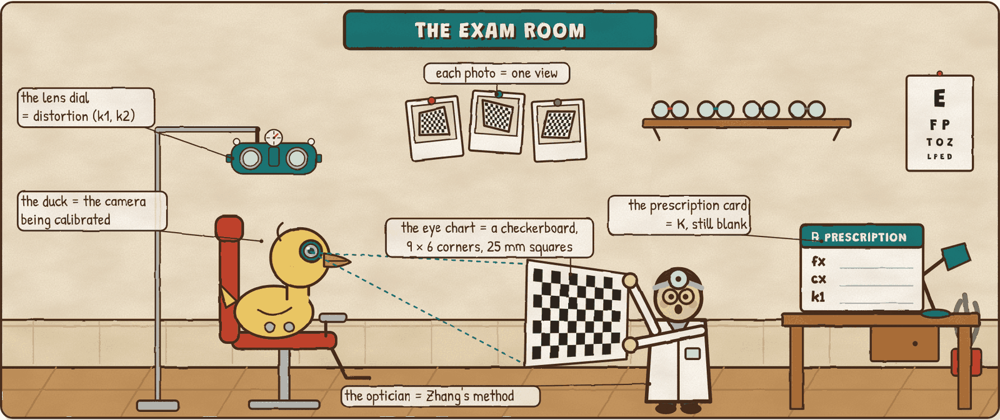
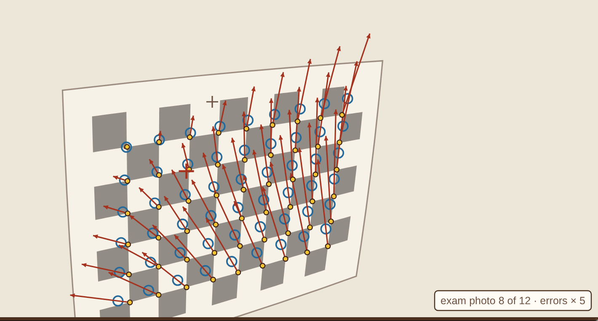

# Eye Exam

**A hands-on lab for how a robot's camera gets calibrated.** Photograph a checkerboard, trace its homography, count the clues each photo gives, solve Zhang's closed form, turn the lens dial, refine with Levenberg–Marquardt, and find out what a bad prescription costs a robot duck in degrees of head turn.

**Play it: https://bakulbadwal.github.io/ducks-eye-view/eye-exam/**

*Step 4: one exam photo graded by the closed form that ignores the lens. The red arrows are the reprojection error, drawn 5× longer; the lens pulled the outer corners in, and a pinhole has nowhere to put that bend but into a wrong K.*

[Duck's-Eye View](https://bakulbadwal.github.io/ducks-eye-view/) turned a pixel into a head turn with the camera's intrinsics taken as given. This lab measures them. The robot is **Microduck**, a 25 cm open-source robot duck ([pollen-robotics/microduck](https://github.com/pollen-robotics/microduck)), and it goes to the optician. The **checkerboard** is the eye chart, each **photo** of it at a new angle is one view, the **tracing card** is a photo's homography, the **clue tally** is the two constraints each photo puts on K, the **prescription card** is K, the **lens dial** is the radial distortion model, and **"better one, or two?"** is Levenberg–Marquardt. Hold that picture and Zhang's paper, and the method inside OpenCV's `calibrateCamera`, read straight through.

The camera every photo is drawn through is Microduck's own: the calibration its repo ships (solved on a real unit on 2026-09-08, 80 views, 0.79 px RMS), rounded and kept to Zhang's two radial terms. So every estimate on the page is shown against the truth.

## What's inside

| Step | You play with | What clicks |
|---|---|---|
| **0 · The Exam Room** | Tilt, turn and move the chart in front of the duck's 1280 × 720 frame; switch the lens on and off; a worked projection of one corner | Five numbers in K plus two lens terms. Microduck's optical axis lands 43 px left of the frame's middle and 115 px below it |
| **1 · One Photo** | Find a photo's homography by DLT, with or without Hartley normalisation; the nine singular values of L; number the corners from an origin up to 3 m away | DLT recovers H exactly with no noise. Normalising barely matters for a near chart (0.189 vs 0.188 px), but for a chart 2.5 m away numbered from 1 m off, the un-normalised median error is 5.41 px and one photo is 2,031 px out |
| **2 · Two Clues** | A tray of tilted, square-on and slid photos; build a set and watch the six singular values of V; 200 sessions at each tilt | Each photo gives 2 equations on B = K⁻ᵀK⁻¹ (5 unknowns): 3 photos, or 2 with skew = 0. Five square-on photos leave 4 zero singular values, the same as one. At 5° of tilt, 45 of 200 sessions blow up |
| **3 · The Closed Form** | Zhang's K from V b = 0 and App. B; every chart's position from K⁻¹H, seen from above; 20 sessions at each count | Exact with no noise. At σ = 0.5 px, the principal point is 8.9 px off from 3 photos and 3.2 px from 12 |
| **4 · The Lens Dial** | k1 and k2 sliders on a bent chart; the exam's 12 photos through the closed form, then the linear distortion fit | Microduck's barrel lens pulls a frame-corner ray 131 px in. Ignoring it, the closed form gets cy = 237 (truth 475), and the linear fit gives k1 = +0.097, the wrong sign, as in Zhang's Table 1 |
| **5 · Better One or Two?** | Levenberg–Marquardt step by step on 78 parameters; RMS per step; five sessions judged by RMS, a hold-out "second opinion" and the answer key | 18.9 px → 0.350 px in 13 steps, k1 back to −0.345. A corner-blind session scores 0.347 px while 58 px wrong in the corners; dropping the worst photos halves a pinhole model's RMS and makes its hold-out error worse |
| **6 · The Fitting** | Book a session (photos, tilt, coverage, corner noise) and see its error map; the head-turn error across the duck's view for four cards | A good 12-photo session turns the head to within 0.05°. A centred pinhole (what Duck's-Eye View assumed) is 6.2° off at the frame's middle: the principal point alone |
| **★ Review Board** | Three bad prescriptions: the flat-lander, the corner-blind, the straight-liner. Pick a fix, re-run, name the cause | The tempting fixes (more of the same photos, sharper corners, dropping the bad photos) fail for the reason the steps taught |
| **✓ Field Test** | Ten questions answered by operating the widgets | Proof it stuck |

Each step has predict-then-reveal questions and a "say it out loud" line that unlocks once you've played. Every term has a tooltip with its plain meaning and its optician's-shop equivalent. Progress is saved in your browser.

## Why this one

| What exists | What it does | What it doesn't |
|---|---|---|
| Kyle Simek's [*Dissecting the Camera Matrix*](https://ksimek.github.io/2013/08/13/intrinsic/) | Interactive demos of what K and [R t] do | How K is estimated |
| [calibDB](https://arxiv.org/abs/1907.04100) (Rojtberg) | Calibrates your own webcam in the browser, guiding you to good poses | Show the math, or a ground truth to compare against |
| OpenCV's calibration tutorial, MATLAB's Camera Calibrator, Bouguet's toolbox | Real tools: your photos in, K and a reprojection error out | Say whether the K is right: there's no answer key |
| [pvphan/camera-calibration](https://github.com/pvphan/camera-calibration) | Zhang's method in Python, with the reprojection error animated per iteration (per its description) | Run in a browser, or connect the error to a robot |
| [Duck's-Eye View](https://bakulbadwal.github.io/ducks-eye-view/) step 5 | Uses K: pixel → bearing → head turn | Estimate K |
| **Eye Exam** | Runs every stage of Zhang's method in the browser on photos through a *known* camera (a real robot's published calibration), so every estimate, every tempting fix and every head-turn error is checked against the truth | Calibrate your own camera: use calibDB or OpenCV for that |

I didn't find an interactive explainer that walks Zhang's method stage by stage against a ground truth; the search was brief, so there may be one.

## Run it

Play it live at the link above, or open `index.html` in a browser. There's no build step, no dependencies, and nothing to install. `node tests/check.js` checks the math and prints every number in [`ACCEPTANCE.md`](ACCEPTANCE.md) (about 8 s).

## What's exact and what's a model

- **The real math**, hand-written in `js/core.js` with no libraries:
  - the DLT and Hartley normalisation (Zhang App. A);
  - Zhang's two constraints per homography, V b = 0 by SVD, K from B (App. B), the extrinsics and the nearest rotation (App. C);
  - the linear distortion fit (eq. 13), and Levenberg–Marquardt on the total reprojection error (eq. 14) with Rodrigues rotations;
  - the reprojection RMS exactly as OpenCV's `calibrateCamera` returns it;
  - the SVD (one-sided Jacobi), the symmetric eigensolver (Jacobi), the 3 × 3 inverse and the Cholesky solve.
  `tests/check.js` checks that DLT recovers a known H and Zhang recovers a known K exactly with no noise, that LM recovers the distortion, that degenerate sets are detected, and every number the page quotes.
- **Teaching models, labelled on the page:**
  - the photos are synthetic: a perfect 9 × 6 chart at 25 mm, seeded poses kept in frame, and a "corner detector" that is the true corner plus Gaussian noise (real detectors get worse on steep or blurry photos; this one doesn't);
  - the true camera is Microduck's published calibration, rounded, with k1 and k2 only (its p1, p2 and k3 move a frame-corner pixel by up to 19 px and are left out);
  - LM holds the skew at 0 by default, as OpenCV does, and uses a numeric Jacobian. OpenCV's own first guess is simpler than Zhang's closed form, and its current solver is a sparse bundle adjustment; this lab follows Zhang's paper;
  - turning a bearing into a head turn assumes the camera looks straight down the head's axis.
- **The directions are real; the numbers are this toy's.** The failure modes (flat photos, an uncovered frame, a model without a lens, a score that rewards dropping hard photos) are the real ones.

Every figure quoted from a paper or the robot's repo is in [`SOURCES.md`](SOURCES.md) with its section or file. Every run is seeded, so it's the same for everyone.

## Sources

- Z. Zhang, [*A Flexible New Technique for Camera Calibration*](https://www.microsoft.com/en-us/research/wp-content/uploads/2016/02/tr98-71.pdf), MSR-TR-98-71 (journal version IEEE TPAMI 22(11), 2000): the spine
- [OpenCV](https://github.com/opencv/opencv) 4.x: `calibrateCamera` and its [calibration tutorial](https://docs.opencv.org/4.x/d4/d94/tutorial_camera_calibration.html)
- R. Hartley, *In Defence of the 8-Point Algorithm* (ICCV 1995), cited by Zhang for normalisation
- [pollen-robotics/microduck](https://github.com/pollen-robotics/microduck) @ `648bf22` (Apache-2.0): `robotd-params/src/lib.rs` (the calibration), `mediad/src/camera.rs`, `duck-detect/src/lib.rs` (the bearing), `uyvy/src/lib.rs` (the quarter turn)
- [Duck's-Eye View](https://github.com/bakulbadwal/ducks-eye-view), step 5

## The series

[Inference Kitchen](https://bakulbadwal.github.io/inference-kitchen/) (serving) · [Finishing School](https://bakulbadwal.github.io/finishing-school/) (post-training) · [Arm Playground](https://bakulbadwal.github.io/arm-playground/) (kinematics and control) · [Policy Pond](https://bakulbadwal.github.io/policy-pond/) (reinforcement learning) · [Fork in the Road](https://bakulbadwal.github.io/fork-in-the-road/) (diffusion policies) · [Duck's-Eye View](https://bakulbadwal.github.io/ducks-eye-view/) (robot vision) · [Demos to Deployment](https://bakulbadwal.github.io/arm-playground/demos-to-deployment/) (imitation learning and real-time execution) · **Eye Exam** (camera calibration)

MIT licensed. Built by [Bakul Badwal](https://www.linkedin.com/in/bakulbadwal/) with Claude Code. Not affiliated with Pollen Robotics.
